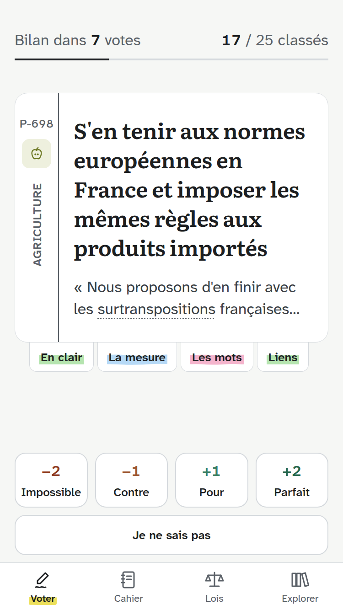
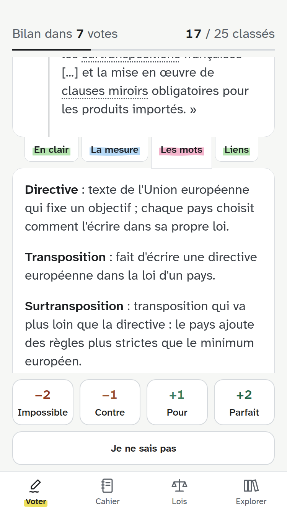
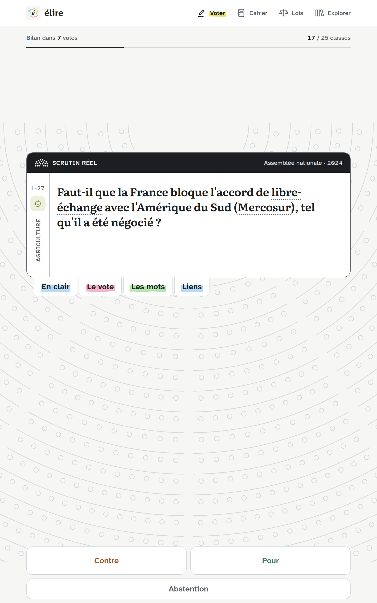
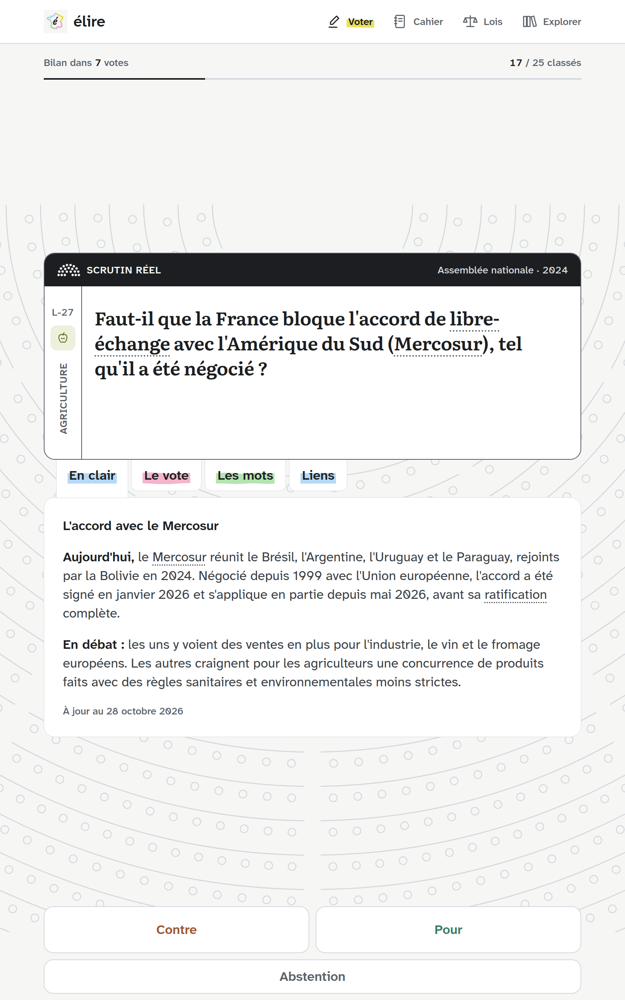
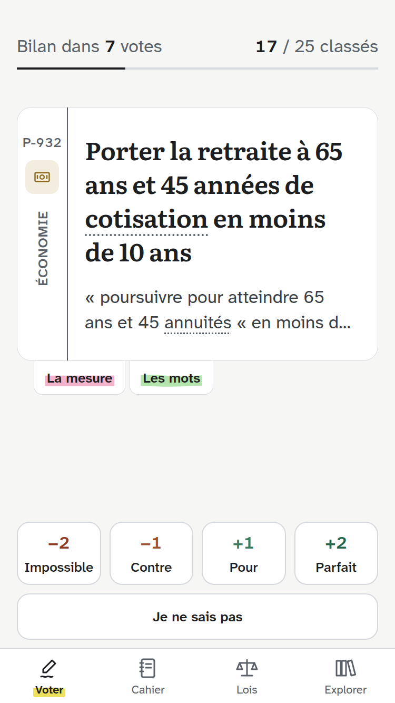

# Corrections : un seul « Signaler une erreur », onboarding qui avance seul, doubles négations, mieux expliquer

Demandes du 2026-10-28. Branche `fix/corrections`.

Légende : **[Danny]** = demandé tel quel, **[Proposition]** = ma proposition, pas encore validée, **[À trancher]** = Danny décide avant la suite, **[Décidé]** = validé ensemble, **[Fait]** = dans le code.

| Lot | Sujet | État |
| --- | --- | --- |
| 1 | Un seul « Signaler une erreur » par feuille | [Fait] |
| 2 | Onboarding : la page avance seule après un essai | [Fait], à tester sur Android |
| 3 | Garde-fou du build contre les tournures négatives | [Fait] |
| 4 | Données : titres et questions reformulés sans double négation, scrutin Mercosur rendu clair | [Fait], explication des votes LFI à sourcer |
| 5 | « En savoir plus » refondu en onglets : intitulés surlignés, mots, liens, données faciles à modifier ; pilote sur 3 éléments | [Fait] pour le pilote, corrections en cours |
| 6 | Repris de `todo.md` : textes plus larges que leur citation, liens anti-robot, cadre des questions communes, astuces, contrôles des enjeux, tests du store | [Fait], 2 liens anti-robot restants |
| 7 | Vérification des données avec les scripts : citations, explications de vote, liens | [Fait] |

Ordre conseillé : 1, 2, 3, 4, puis 5 (le lot 5 reprend le Mercosur comme premier cas d'usage).

### Avancement du dev (2026-10-28)

Vérifié : `npx tsc --noEmit`, `npx expo lint`, `npm test` (89 tests), `npm run build:data:strict`, `npm run check:links` (268 liens, 0 erreur, 7 à lire déjà connus). Rendu vu en web sur iPhone SE (375 × 667) : `prop-dl-8` et le scrutin Mercosur. Pas encore vu sur Android ni iOS natif.

- **Lot 1** : `SharedQuestion` n'a plus de bouton ; le signalement du bas cite « P-xxx, E-xx ».
- **Lot 2** : `onboarding.tsx`, un seul effet pour la lecture automatique et le passage après un essai (`TRY_NEXT_MS` 1,2 s, `SOURCE_NEXT_MS` 1,8 s, `SHEET_NEXT_MS` 0,6 s) ; rien ne tourne seul avec un lecteur d'écran.
- **Lot 3** : `src/lib/wording.ts` (`negativeWording`, tests), avertissement au build ; le refus (« refuse », « rejet ») n'est contrôlé que dans les questions de scrutin (sinon « la liberté de refuser un vaccin » sortait).
- **Lot 4** : les 6 titres, `normes-agricoles` (question et enjeu), `eoliennes` (enjeu), question et `enjeu` court du Mercosur. `docs/verification-donnees.md`, demandé par le skill, n'existe plus dans le dépôt : consigné ici.
- **Lot 5** :
  - Données : **`data/mots.json`** (14 mots) au lieu d'une union dans `glossaire.json` : les 48 sigles et leurs contrôles ne bougent pas. `data/reperes.json` (3 repères). Contrôles au build : ids connus, un repère par élément, anonymat, sigles, apostrophes, lien précis, mot employé nulle part, forme en double.
  - Code : `MotSchema`, `LienSchema`, `RepereSchema` ; `wordsIn` et `wordSpans` (`glossary.ts`, tests) ; `NATURE_EXPLAINED` (`format.ts`) ; `getRepere` ; `GlossaryText` (mot souligné, toucher = « Les mots ») ; `MoreInfo` réécrit en onglets ; `PropositionSheet` gagne `footer` et `onWord`.
  - **Écart avec le croquis** : la rangée d'onglets est en pied de carte **sur toute sa largeur**, sous la marge. Dans la colonne de texte, l'iPhone SE n'a que 255 pt pour environ 300 pt d'onglets ; sur toute la largeur, ils tiennent sur une ligne. La rangée défile à l'horizontale si la police est agrandie.
  - Ouvrir un onglet fait défiler jusqu'à mettre la rangée d'onglets en haut de l'écran (`measureLayout`), pas tout en bas.
  - Web : un mot souligné est un lien (`role="link"`), un bouton cassait la ligne (« ( » seul en fin de ligne).
  - « répartition » seul touchait la répartition du travail et des demandeurs d'asile : devenu « retraite par répartition » (variante « par répartition »).
  - Faits vérifiés sur Wikipédia : Mercosur créé en 1991, Bolivie en 2024, accord signé le 17 janvier 2026, appliqué à titre provisoire depuis le 1er mai 2026. Retraites : l'âge « gelé à 62 ans et 9 mois » n'a pas été confirmé, remplacé par la suspension jusqu'en janvier 2028 déjà sourcée dans `lois.json`.
  - Tuto `en-savoir-plus` réécrit pour les onglets.
  - **Onglet actif** [Danny] : on ne voyait pas lequel était ouvert. Plus de surligneur par défaut : les onglets fermés sont en graphite, l'onglet ouvert est en encre et surligné de biais avec le feutre du lecteur, comme l'onglet actif de la barre du bas (`TabMark`, sorti de `app-tabs.tsx` et partagé). Remplace « une couleur par onglet parmi les 3 autres surligneurs ». Option écartée pour l'instant : un fond plus épais sur les onglets (retour aux gros boutons).
- **Liens** : `npm run check:links` et un job `liens` dans `.github/workflows/verifications.yml` (échoue sur un 404 ou un domaine disparu, pas sur un site anti-robot). Le script lisait déjà tous les JSON de `data/`, `reperes.json` compris.

Reste à faire :

- Détection des mots difficiles au build (liste Lexique 3.83 et liste de termes politiques) : en attente de l'accord pour télécharger Lexique.
- Explication sourcée du vote LFI sur le Mercosur ; `resume` (485 / 69) à comparer au scrutin officiel.
- Vidéos à trouver à la main ; lien vie-publique.fr à vérifier.
- Phase 2 : les onglets dans `PropositionDetail` et `LoiDetail`.
- Mises à jour de CONTRIBUTING.md, DESIGN.md et PRODUCT.md.

---

## 1. Un seul « Signaler une erreur »

**[Danny]** Deux « Signaler une erreur » apparaissent parfois sur la même page.

**Cause** : la feuille d'une proposition liée à une question commune (42 propositions sur la base actuelle) affiche deux boutons, dans [proposition-detail.tsx](../src/components/proposition-detail.tsx) :

- « Signaler une erreur sur la question », dans le bloc `SharedQuestion` (ligne 115), **avant** « Ouvrir la source » ;
- « Signaler une erreur », en bas de la feuille (ligne 77).

Le lien du pied de page (`DataFooter`) n'est pas en cause : il reste derrière la feuille, jamais à l'écran en même temps. Les feuilles d'un scrutin (`LoiDetail`) n'ont qu'un bouton.

**Correctif** [Proposition] : retirer le bouton de `SharedQuestion` et garder celui du bas. Le signalement reprend les deux références pour que le relecteur sache tout de suite si l'erreur peut venir de la question :

- `reportUrl(enjeu ? \`${proposition.ref}, ${enjeu.ref}\` : proposition.ref, proposition.titre)` (ex. « Erreur P-531, E-03 : … ») ;
- `SharedQuestion` n'importe plus `reportUrl` ni `Linking`.

**Vérification** : ouvrir dans Explorer une proposition d'une question commune (ex. `prop-ga-6`, question E-17) : un seul bouton, en bas ; le lien ouvert contient les deux références. `npm run check` passe.

---

## 2. Onboarding : avancer après chaque essai

**[Danny]** Quand on vote, ça devrait passer à la page suivante, et pareil pour chaque action, pour ne pas se sentir piégé.

**Ce qui se passe aujourd'hui** ([onboarding.tsx](../src/app/onboarding.tsx)) : le moindre toucher sur une démo met `held` à vrai. La lecture automatique (15 s) s'arrête pour de bon, le trait du haut reste plein, et la seule sortie est une zone de toucher invisible (les deux tiers droits) ou un glissement. D'où le sentiment d'être bloqué.

**[Décidé]** Comme dans Voter, où une proposition votée part seule après son geste (trait du bouton 220 ms, surligneur 260 ms) : une action terminée = on montre son effet, puis la page tourne. Un essai non terminé (on touche sans choisir) garde la page, comme aujourd'hui. **Pas de bouton « Suivant »** [Danny].

| Page | Action qui termine l'essai | Délai avant la page suivante |
| --- | --- | --- |
| Votre surligneur | choisir une couleur (un nouveau choix relance le délai) | 1,2 s |
| Neutralité | voter sur l'exemple | 1,2 s |
| Changer d'avis | corriger le vote dans la feuille (elle se ferme déjà seule après 650 ms) | 0,6 s après la fermeture |
| Transparence | toucher « Ouvrir la source » (le message « La page s'ouvrira… » s'affiche) | 1,8 s |

Règles :

- Pendant ce délai, le trait du haut se remplit vite : on voit que la page va tourner, rien n'arrive par surprise.
- Lecteur d'écran actif : pas de passage automatique (le focus sauterait). Les zones « Page suivante » restent.
- Fermer la feuille de la gomme sans voter : la page reste.

**Mise en œuvre** (tout dans `onboarding.tsx`) :

- Constantes `TRY_NEXT_MS = 1200`, `SOURCE_NEXT_MS = 1800`, `SHEET_NEXT_MS = 600`, commentées sur une ligne.
- État `soon: { ms: number; at: number } | null` (le `at` relance le délai à chaque nouveau choix) et `nextSoon(ms: number)` qui le pose, sauf lecteur d'écran.
- Un `useEffect` sur `soon` : `progress.value = 0`, puis `withTiming(1, { duration: ms })` et `setTimeout(() => goTo(index + 1), ms)`, nettoyé au démontage. `goTo` remet `soon` à `null`.
- `MarkerPicker onSelect` : `setPicked` puis `nextSoon(TRY_NEXT_MS)`.
- `VoteDemo onVote` : `voteExample` puis `nextSoon(TRY_NEXT_MS)`.
- `EraserDemo` reçoit `onDone: () => void`, appelé à la fermeture de la feuille si un vote y a été posé (l'`onVote` de la gomme ne fait plus tourner la page lui-même).
- `SourceDemo` reçoit `onDone`, appelé au toucher de « Ouvrir la source ».

**Vérification** (pas de test de composant dans le dépôt : à la main, web puis Android) :

- chaque page interactive tourne seule après son action, avec le trait qui se remplit ;
- surligneur : deux choix rapides, la page tourne 1,2 s après le second ;
- gomme : ouvrir puis fermer la feuille sans voter, la page reste ;
- lecteur d'écran (TalkBack ou VoiceOver) : rien ne tourne seul ;
- `npx tsc --noEmit` et `npx expo lint` passent.

---

## 3. Garde-fou : tournures négatives au build

**[Proposition]** La règle existe déjà (CONTRIBUTING, règle 12 : « Questions directes et sans double négation »), mais rien ne la vérifie. Le build contrôle déjà les sigles et l'anonymat : on ajoute un avertissement de la même façon.

- Nouveau `src/lib/wording.ts` : `negativeWording(text: string): string | null`, qui rend la raison ou `null`.
  - signale un texte qui commence par une négation : `Ne pas`, `Ne plus`, `N'`, `Non` (ou `Faut-il ne pas`, `Faut-il ne plus`) ;
  - signale une question de scrutin qui porte un refus : `refuse`, `rejette`, `rejeter`, `Rejet de`.
- Test `src/lib/__tests__/wording.test.ts` :
  - `'Ne pas taxer les voitures électriques'` → signalé ;
  - `'Faut-il ne plus imposer…'` → signalé ;
  - `"Faut-il que la France refuse, en l'état, l'accord…"` → signalé ;
  - `'Régulariser tous les sans-papiers'` → `null` (« sans » au milieu n'est pas visé) ;
  - `'Construire de nouveaux réacteurs nucléaires'` → `null`.
- [scripts/build-data.ts](../scripts/build-data.ts) : `warnings.push` pour le `titre` de chaque proposition, la `question` de chaque scrutin et de chaque question commune. Avertissement, donc bloquant en `--strict` seulement.

**Vérification** : `npm test` passe ; `npm run build:data` liste exactement les textes du lot 4, puis plus rien une fois le lot 4 fait.

---

## 4. Données : reformuler sans double négation

**[Danny]** Textes à revérifier pour éviter les doubles négations.

**Analyse** : les textes de l'interface n'en ont pas (passage au script sur `src/`, `tutos.json`, `legal.ts` : des négations simples, correctes). Le vrai problème est dans les **données lues à l'aveugle** : un titre négatif, noté « Contre » ou « Impossible », donne « contre ne pas taxer ». Chaque reformulation passe par le skill `verifier-donnees` (CONTRIBUTING, règle 6 : titre fidèle à la citation, rien d'ajouté ni de retiré).

### Questions communes (`data/enjeux.json`) [Décidé]

| Id | Aujourd'hui | Nouveau texte |
| --- | --- | --- |
| `normes-agricoles` (question) | Ne plus imposer aux agriculteurs des règles plus strictes que celles de l'Europe | Limiter les règles imposées aux agriculteurs à celles de l'Europe |
| `normes-agricoles` (enjeu) | Supprimer ou ne plus ajouter les normes françaises qui vont au-delà… | Supprimer les normes françaises qui vont au-delà de ce que l'Union européenne exige, et ne plus en ajouter. |
| `eoliennes` (enjeu) | Ne plus autoriser de nouvelles éoliennes et démonter… | Interdire les nouvelles éoliennes et démonter, progressivement ou non, celles déjà en service. |

Même sens, mêmes positions : pas de migration des votes.

### Titres de propositions (`data/candidats/*.csv`) [Décidé]

| Id | Aujourd'hui | Nouveau titre |
| --- | --- | --- |
| `prop-xb-4` | Ne pas taxer les voitures électriques | Exonérer les voitures électriques de toute nouvelle taxe |
| `prop-ga-6` | Ne plus ajouter de règles françaises en plus des normes européennes pour les agriculteurs | S'en tenir aux normes européennes pour les agriculteurs |
| `prop-dl-8` | Ne plus durcir les normes européennes en France et imposer les mêmes règles aux produits importés | S'en tenir aux normes européennes en France et imposer les mêmes règles aux produits importés |
| `prop-kb-7` | Ne pas imposer aux agriculteurs français des règles qu'on n'exige pas des producteurs étrangers | Imposer aux agriculteurs français les mêmes règles qu'aux producteurs étrangers |
| `prop-jl-6` | Interdire tout projet éolien que le maire n'a pas validé après avoir consulté les habitants | Soumettre tout projet éolien à l'accord du maire, après consultation des habitants |
| `prop-jlm-7` | Inscrire dans la Constitution qu'on ne prélève pas plus à la nature qu'elle ne peut reconstituer | Inscrire dans la Constitution la « règle verte » : prélever au plus ce que la nature peut reconstituer |

Gardés tels quels : les « sans baisse de salaire », « sans-papiers », « sans prime majoritaire » (une seule négation, au milieu du titre).

### Scrutin Mercosur (`data/lois.json`, `debat-accord-ue-mercosur-2024`)

**[Danny]** C'est compliqué, mais il faut vraiment améliorer la compréhension et rendre les choses faciles à comprendre.

Question actuelle : « Faut-il que la France refuse, en l'état, l'accord de libre-échange entre l'Union européenne et le Mercosur ? ». Trois obstacles à la compréhension :

- « refuse » : voter « Contre » = contre le refus, la double négation que la règle 12 interdit ;
- « Mercosur » n'est expliqué nulle part : le glossaire ne lit que les sigles en capitales ;
- ce vote ne fait pas une loi : c'est une déclaration du gouvernement (article 50-1), un vote de soutien. Rien ne le dit à l'aveugle.

**Incohérence relevée** : inverser la question (« accepter l'accord ») oblige à inverser toutes les positions. Or le groupe LFI a voté contre cette déclaration (0 pour, 69 contre) alors qu'il s'oppose à l'accord. Inversé, Jean-Luc Mélenchon apparaîtrait favorable au Mercosur, ce qui est faux.

**[Décidé]** On garde les positions telles quelles et on rend le vote clair. Ce qu'est le Mercosur s'explique dans « En savoir plus » (lot 5, élément pilote).

| Champ | Nouveau texte |
| --- | --- |
| `question` | Faut-il que la France bloque l'accord de libre-échange avec l'Amérique du Sud (Mercosur), tel qu'il a été négocié ? |
| `enjeu` | L'accord baisserait les droits de douane entre l'Union européenne et le Brésil, l'Argentine, l'Uruguay et le Paraguay : plus de voitures et de machines européennes vendues là-bas, plus de viande, de sucre et de soja importés ici. Les agriculteurs français craignent une concurrence aux règles moins strictes. |
| `explication` des votes LFI | La raison de leur vote contre, citée et sourcée (`verifier-donnees`) |

- « bloquer » est un verbe d'action, comme « quitter » ou « démanteler » des questions communes : « Pour » = bloquer, sans ambiguïté.
- Le lot 5 ajoute « Mercosur » au glossaire, la partie « Ce que vous votez » (déclaration du gouvernement : vote de soutien, sans effet de loi) et un `enjeu` raccourci.
- Pas de migration : le sens de « Pour » ne change pas (bloquer = refuser).
- Les `titre` officiels (« Rejet de… ») restent : ils ne sont pas lus à l'aveugle.

**Vérification** : `npm run build:data` sans avertissement du lot 3, `npm run check` passe, `check-sources.mjs` sur les propositions et le scrutin touchés.

---

## 5. « En savoir plus » refondu en fiches à tirer

**[Danny]** Le retour le plus fréquent : « moi j'y comprends rien à la politique, et il manque vraiment beaucoup d'explications. Je clique sur « En savoir plus » et ça ne m'aide pas. » Refondre la section : plus d'infos bien lisibles, titres des parties surlignés (couleur au hasard parmi les 4 surligneurs), des définitions, des liens utiles et des vidéos. Le plus important : des infos lisibles et faciles à modifier dans les données. Pilote sur 3 éléments seulement, pour une relecture propre.

Brief de design : deux passes `shape` d'impeccable, faites le 2026-10-28 par un agent (monde « Le cahier annoté », sans new-work). Ce lot en reprend les décisions.

### Pourquoi « En savoir plus » n'aide pas aujourd'hui

[more-info.tsx](../src/components/more-info.tsx), dans Voter, affiche deux choses :

1. **Un glossaire limité aux sigles en capitales** (`acronymsIn`) : 48 entrées, surtout des médias et des organismes (AFP, BFM, ANSSI). « Mercosur », « surtransposition » ou « capitalisation » n'y sont pas.
2. **Le contexte**, écrit pour vérifier la source, pas pour expliquer. Rien ne dit ce qui existe aujourd'hui ni ce qui est en débat.

Pas de lien : la source d'une proposition trahirait son auteur, et la page officielle d'un scrutin donne son résultat.

### Des fiches à tirer, à la place de « En savoir plus »

**[Danny]** Plus de bouton « En savoir plus » unique : des sections fermées, visibles d'emblée, qu'on ouvre comme des tiroirs (aspect « bureau »). Elles doivent aussi remplir le vide de la feuille sur tablette (captures `assets/images/screenshots/android/tablette-10/2-voter.png` et `apple/ipad-13/3-scrutin.png` : feuille centrée, grand vide au-dessus et au-dessous).

**Métaphore** [Proposition] : on garde le geste « tirer », pas le meuble. Un tiroir dessiné (bois, poignées, ombres) tombe dans le gadget, et un tiroir appartient au bureau, pas au cahier. L'objet retenu est la **fiche de révision à onglet** : l'élève surligne le titre de ses fiches, et le Classement utilise déjà des fiches. Écartés : intercalaires (barre d'onglets banale), pochettes, post-it, marque-pages. Moyens du monde seulement : filet, coins de 8, fond papier pour la fiche ouverte. Ni ombre, ni ruban, ni texture.

**Les fiches** :

| Ordre | Fiche | Proposition | Scrutin | Question commune |
| --- | --- | --- | --- | --- |
| 1 | **En clair** | « Aujourd'hui » puis « En débat » (repère partagé) | idem | idem |
| 2 | **La mesure** / **Le vote** / **La question** | type de source et `contexte`, comme aujourd'hui | phrase « Ce vote » (nature du scrutin), puis `enjeu` | `enjeu` |
| 3 | **Les mots** | sigles et mots, dans l'ordre d'apparition | idem | idem |
| 4 | **Liens** | 0 à 3 liens neutres (article, vidéo, audio) | idem | idem |

- Fermée : tuile blanche à filet, 44 pt (48 sur Android), intitulé surligné, compte en graphite (« Les mots 4 », « Liens 1 »), chevron.
- Une fiche vide n'apparaît pas. La 2 est toujours là (`contexte` et `enjeu` sont obligatoires).
- **Une fiche ouverte à la fois** : en tirer une range l'autre ; toucher la fiche ouverte la referme. Le contenu sort sous la grille, sur fond papier, de 8 pt vers le bas avec un fondu (180 ms, sans rebond) ; tout est posé d'un coup si les animations sont réduites.
- Tout se referme à chaque nouvelle feuille [Décidé].
- Lecteur d'écran : chaque onglet est un bouton déplié ou replié (« Les mots, 4 mots expliqués, replié ») ; le groupe s'appelle « En savoir plus » ; à l'ouverture, le focus va sur le contenu.
- Ouvrir une fiche déplie aussi la citation coupée à 2 lignes, comme « En savoir plus » aujourd'hui.

**Intitulés surlignés** [Décidé] : surligneur tiré parmi les 3 autres que celui du lecteur, graine = id de l'élément (le hachage `waveOf` de `marked.tsx`, à mettre en commun). Rendu de `Marked`, sans animation.
- [Proposition] **Une seule couleur par élément** pour toutes ses fiches : 4 fiches pour 3 couleurs forcent une répétition, et 3 couleurs plus le balayage du vote font confettis. La couleur change d'une feuille à l'autre.
- [Proposition] **Questions communes** : intitulés en encre, sans surligneur, car leur cadre porte déjà les 4 couleurs.
- DESIGN.md (règle du surligneur du lecteur) gagne une exception nommée, comme le cadre des questions communes.

**Mots du glossaire** [Proposition] : souligné pointillé graphite, première occurrence, **dans le titre et la citation seulement**. Toucher un mot ouvre « Les mots » sur son entrée. Pas d'infobulle. Sur Android, le pointillé tombe en trait plein (à vérifier sur RN 0.86).

**Liens** : ligne de 44 pt, titre en encre, dessous « Wikipédia · article » ou « Lumni · vidéo · 4 min » en graphite, icône `open-outline`. Ouverture dans le navigateur (`Linking.openURL`) : pas de lecteur vidéo intégré (requêtes tierces et traceurs, contraire à PRODUCT.md).

### Mise en page par taille

Hauteurs estimées d'après le code, à mesurer sur appareil.

| Écran | Fiches | Verdict |
| --- | --- | --- |
| iPhone SE, Android 360 × 640 | **grille 2 × 2**, intitulé et compte | Environ 325 pt libres pour la feuille. 4 fiches empilées : environ 360 pt, ça déborde. Grille : environ 280 pt (312 avec un titre de 3 lignes), ça tient. Le bandeau de vote reste fixe et la réserve de « A voté ! » est respectée |
| Téléphone standard | grille 2 × 2 | Large marge ; une fiche ouverte fait défiler, le vote reste en bas |
| Tablette 7 et 10 pouces, iPad 13, en portrait | grille 2 × 2 de **fiches avec 2 lignes d'aperçu** | Le vide sert : l'aperçu informe déjà sans rien ouvrir |
| Paysage large (1100 pt et plus) | grille avec aperçu, dans la feuille | Comme la tablette portrait |

Aperçus tirés des données, sans rien saisir de plus :
- En clair : titre du repère et début de « Aujourd'hui » ;
- La mesure : type de source et début du contexte ; Le vote : la nature (« Déclaration du gouvernement ») ;
- Les mots : la liste (« Mercosur, libre-échange, droits de douane… ») ;
- Liens : éditeurs et types (« Wikipédia · Lumni, vidéo »).

Avec 1 fiche : pleine largeur ; 2 : sur une ligne ; 3 : 2 + 1, la dernière en pleine largeur. Fiche ouverte : l'aperçu des onglets disparaît.

**Position de la feuille** [Proposition] : aujourd'hui elle est centrée verticalement (`stage`, `justifyContent: 'center'` dans `index.tsx`), donc le titre remonterait à chaque ouverture. On fige la position par feuille et on n'ouvre que vers le bas. Le contenu ouvert s'affiche sous la grille et la page défile jusqu'à lui (décision 6).

**Scrutins** : les fiches sont dans la feuille, sur le blanc, sous la question. Le bandeau « Scrutin réel », le tampon et l'hémicycle de fond ne changent pas ; le contour dessiné suit la feuille plus haute.

### Maquettes

`▒Mot▒` = intitulé surligné, `·····` = mot souligné au crayon.

Téléphone (iPhone SE), fermé, `prop-dl-8` :

```
┌────┬─────────────────────────────────┐
│P-698│S'en tenir aux normes           │
│ ☘  │ européennes en France et        │
│    │ imposer les mêmes règles aux    │
│ A  │ produits importés               │
│ G  │ « Nous proposons d'en finir     │
│ R  │ avec les surtranspositions […]  │
│ I  │          ················       │
│ C  │ ─────────────────────────────── │
│ U  │ ┌─────────────┐ ┌─────────────┐ │
│ L  │ │▒En clair▒  ˅│ │▒La mesure▒ ˅│ │
│ T  │ └─────────────┘ └─────────────┘ │
│ U  │ ┌─────────────┐ ┌─────────────┐ │
│ R  │ │▒Les mots▒ 4˅│ │▒Liens▒   1 ˅│ │
│ E  │ └─────────────┘ └─────────────┘ │
└────┴─────────────────────────────────┘
          (réserve de « A voté ! »)
[Impossible][ Contre ][ Pour ][ Parfait]
[            Je ne sais pas            ]
```

Téléphone, « Les mots » ouvert (la page défile, le bandeau de vote reste fixe) :

```
│ R  │ ┌─────────────┐ ┌─────────────┐ │
│ E  │ │▒Les mots▒ 4˄│ │▒Liens▒   1 ˅│ │
│    │ └─────────────┘ └─────────────┘ │
│    │ ┌─────────────────────────────┐ │
│    │ │ ▒Les mots▒                  │ │
│    │ │ Directive : texte de l'Union│ │
│    │ │ européenne qui fixe un      │ │
│    │ │ objectif ; chaque pays […]  │ │
│    │ │ Transposition : […]         │ │
│    │ │ Surtransposition : […]      │ │
│    │ │ Clause miroir : […]         │ │
│    │ └─────────────────────────────┘ │
└────┴─────────────────────────────────┘
```

Tablette portrait, fermé, scrutin Mercosur :

```
┌──────────────────────────────────────────────────────────────┐
│▓ SCRUTIN RÉEL                      Assemblée nationale · 2024│
├────┬─────────────────────────────────────────────────────────┤
│L-27│ Faut-il que la France bloque l'accord de libre-échange  │
│ ☘  │ avec l'Amérique du Sud (Mercosur), tel qu'il a été      │
│ A  │                         ········                        │
│ G  │ négocié ?                                               │
│ R  │ ─────────────────────────────────────────────────────── │
│ I  │ ┌──────────────────────────┐ ┌──────────────────────────┐│
│ C  │ │▒En clair▒              ˅ │ │▒Le vote▒               ˅ ││
│ U  │ │ L'accord avec le Mercosur│ │ Déclaration du           ││
│ L  │ │ Le Mercosur réunit le […]│ │ gouvernement             ││
│ T  │ └──────────────────────────┘ └──────────────────────────┘│
│ U  │ ┌──────────────────────────┐ ┌──────────────────────────┐│
│ R  │ │▒Les mots▒            4 ˅ │ │▒Liens▒                1 ˅││
│ E  │ │ Mercosur, libre-échange, │ │ Wikipédia                ││
│    │ │ droits de douane, […]    │ │                          ││
│    │ └──────────────────────────┘ └──────────────────────────┘│
└────┴─────────────────────────────────────────────────────────┘
        (hémicycle de fond inchangé ; le vide du bas reçoit
         la fiche ouverte)
[            Contre            ][            Pour             ]
[                         Abstention                          ]
```

### Maquette du 2026-10-28

Maquette HTML aux couleurs et polices de l'app (rendu web, pas natif : sur Android, le pointillé devient un trait plein et le surligneur un fond de ligne) :

| Téléphone (iPhone SE), fermé | Téléphone, « Les mots » ouvert |
| --- | --- |
|  |  |

| Tablette portrait, fermé | Tablette portrait, « En clair » ouvert |
| --- | --- |
|  |  |

Constats :

- **Titres trop longs sur petit écran** : `prop-dl-8` fait 5 lignes sur iPhone SE. La grille tient, mais le bas de la feuille passe sous le bandeau de vote. Ce n'est pas dû aux fiches. [À trancher] titre en taille réduite sous 380 pt de large, ou titres plus courts (règle 7 de CONTRIBUTING : environ 90 caractères).
- **« Les mots » ouvert sur iPhone SE** : moins de 2 définitions visibles à la fois, il faut défiler.
- **Vide sur tablette** : fermée, la feuille n'occupe que la moitié de l'écran. Avec une fiche ouverte, il reste environ 240 pt en bas.
- **Couleurs** : 3 surligneurs sur les fiches et le jaune de « Voter » restent calmes. Risque à tester : croire qu'une couleur veut dire une fiche (« vert = En clair »), alors qu'elle change à chaque feuille.
- **Intitulé répété retiré** : le contenu ouvert ne reprend pas l'intitulé, déjà visible sur l'onglet juste au-dessus.
- **Souligné pointillé** : bien visible sur le titre comme sur la citation, sans gêner la lecture.

### Maquette v2 : onglets sous la feuille

Première version (grille 2 × 2) gardée dans [v1/](feature-20261028-corrections/v1/), deuxième dans [v2/](feature-20261028-corrections/v2/). Les images du tableau ci-dessus sont la v3 (section suivante), plus :

| Élément sans repère ni lien (rangement à gauche) |
| --- |
|  |

- Onglets sur une ligne, 8 pt sous le bord de la feuille, qui se chevauchent un peu ; environ 28 pt visibles, zone de toucher de 44 pt invisible. Pas de compteur.
- L'onglet ouvert, un peu plus grand, se prolonge dans la fiche blanche qui sort de sous la feuille.
- Ordre gardé : En clair, La mesure / Le vote, Les mots, Liens (« Le vote » dit « ce vote ne crée pas de loi », à lire juste après « En clair »).
- iPhone SE : les 4 onglets font 292 pt pour 343 pt de colonne, ils tiennent. Si la police est agrandie : marges réduites, puis défilement horizontal de la ligne, jamais de retour à la ligne.
- Mots soulignés partout, contenu des fiches compris (« ratification » dans « En clair »).

Constats :

- Beaucoup plus léger, et le lien entre l'onglet tiré et sa fiche se comprend tout de suite.
- Onglets peut-être trop discrets pour des débutants : seul le surligneur les signale. À tester au doigt.
- **Grand blanc dans la feuille d'un scrutin** sous la question : il vient de la hauteur minimale réservée au thème écrit à la verticale (« AGRICULTURE », 221 pt). [Proposition] réduire cette hauteur minimale (thème en plus petit, ou à l'horizontale dans la ligne d'infos quand la question est courte).
- **Vide sur tablette, tout fermé** : plus grand qu'en v1 (environ 800 pt entre les onglets et le vote). Il ne se remplit qu'à l'ouverture d'une fiche.

### Forme retenue : onglets dans la carte [Décidé]

**[Danny]** Les maquettes v1 à v3 sont trop laides. Forme à développer, corrections une fois le dev commencé :

```
Fermé                                   Ouvert
┌──────────────────────────────┐        ┌──────────────────────────────┐
│ carte de vote                │        │ carte de vote                │
│ (titre, citation)            │        │ (titre, citation)            │
│ ──────────────────────────── │        │ ──────────────────────────── │
│ ▒En clair▒˅ ▒La mesure▒˅     │        │ ▒En clair▒˄ ▒La mesure▒˅     │
│ ▒Les mots▒˅ ▒Liens▒˅         │        │ ▒Les mots▒˅ ▒Liens▒˅         │
└──────────────────────────────┘        │ Sous-titre de l'onglet       │
                                        │ infos, présentées selon      │
                                        │ l'onglet                     │
                                        └──────────────────────────────┘
```

(Le croquis passe à la ligne pour tenir ; dans l'app, les 4 onglets sont sur une seule ligne.)

- Les onglets sont **dans la carte de vote**, sous le filet de séparation qui reste dans la carte, comme aujourd'hui au-dessus de « En savoir plus ».
- **Pas d'arrondi en bas** de la partie vote : rien ne se détache, les onglets sont la fin de la carte.
- Chaque onglet : intitulé surligné et **flèche** (`chevron-down` fermé, `chevron-up` ouvert, Ionicons 16, `Colors.graphite`). Pas de compteur, pas de tuile ni de bordure autour de l'onglet.
- Ouvert : sous la rangée, un **sous-titre de l'onglet** (titre du repère pour En clair, type de source pour La mesure, nature du scrutin pour Le vote ; rien pour Les mots et Liens), puis les infos, présentées selon l'onglet (règles « Fiche ouverte » ci-dessous).
- Inchangé : une seule ouverte à la fois, fiches vides absentes et rangées à gauche, une couleur par onglet hors surligneur du lecteur, défilement jusqu'au contenu, tout refermé à chaque feuille, mots soulignés partout.
- **iPhone SE** : 4 intitulés en `labelStrong` et 4 flèches de 16 pt, environ 330 pt pour 343 pt : ça tient de justesse, à vérifier au dev. Sinon : flèche de 12 pt, puis défilement horizontal de la rangée.

Dans la section suivante, ne valent plus que « Fiche ouverte », « Couleurs », « Animation et défilement » et « Lecteur d'écran ». La rangée hors de la carte, les languettes et le prolongement de l'onglet sont abandonnés.

### Maquette v3 et comment rendre les fiches propres

**[Danny]** La v2 est laide (capture gardée dans [v2/](feature-20261028-corrections/v2/)). Passe `critique` puis `polish` d'impeccable par un agent neuf. Les images du tableau plus haut sont maintenant la v3.

**Pourquoi la v2 était laide** :

1. Quatre bords gauches différents (feuille, fiche en retrait, premier onglet, texte), et un premier onglet coincé dans l'arrondi de la feuille.
2. Onglets qui se chevauchent : filets doublés et coupés, effet « dossier de bureau » bon marché.
3. Libellé décentré dans l'onglet, surligneur qui remplit presque toute la languette : on lit des gommettes, pas des onglets.
4. Lien onglet-fiche raté : la fiche remonte sous les onglets, l'onglet ouvert ne dépasse que de 6 pt, ouvert et fermé ont le même fond.
5. Trois épaisseurs de filet et trois rayons : feuille, onglets et fiche ne semblent pas faits de la même main.
6. Onglets qui flottent à 8 pt sous la feuille, trop petits sur tablette.
7. « Les mots » : entrées hors de la grille de 8, « : » qui peut partir seul à la ligne.

**Principe** : les intercalaires pendent du bord bas de la feuille. L'onglet tiré descend de 8 pt et se prolonge sans couture dans sa fiche, aussi large que la feuille. Rien ne se chevauche, et il n'y a que deux bords gauches : le bord de la colonne et un retrait de 16.

**Rangée d'onglets**

- Une ligne, sans retour : `flexDirection: 'row'`, `gap: Spacing.half` (4), `paddingHorizontal: Spacing.two` (16) depuis le bord de la feuille, donc hors de son arrondi.
- Le haut des onglets passe sous la feuille (`marginTop: -1`, zIndex sous la feuille) : ils partent du filet, sans vide.
- Seules les fiches non vides, dans l'ordre En clair, La mesure / Le vote / La question, Les mots, Liens, rangées à gauche. Ni compteur ni chevron.

**Onglet fermé**

- Téléphone : 32 pt visibles (plus 1 caché sous la feuille), padding 7 en haut et 12 sur les côtés, libellé `Type.labelStrong` (13/18), `Colors.ink`.
- Tablette (colonne de 600 pt et plus) : 40 pt visibles, padding 8 / 16, libellé `Type.bodyStrong` (17/24).
- Fond `Colors.sheet`, filet `StyleSheet.hairlineWidth` en `Colors.rule` à gauche, à droite et en bas, pas en haut. Coins bas de 8, coins hauts carrés.
- Cible de 44 pt (48 sur Android) par `hitSlop` vers le bas : 12 (16 sur Android) au téléphone, 4 (8) sur tablette, plus 2 sur les côtés.
- Pressé : fond `Colors.pressed`. Focus web : contour 2 en `Colors.focus`, décalé de 2.

**Onglet ouvert**

- Le même, plus long de 9 (42 pt au téléphone, 50 sur tablette), `marginBottom: -9` : la rangée garde sa hauteur.
- Coins bas carrés, zIndex au-dessus de la fiche : il couvre le filet haut de la fiche sur sa largeur, d'où la couture invisible.
- Libellé inchangé (graisse, couleur) : l'état se lit à la forme.
- Pressé : il reste en `Colors.sheet`, sinon la couture se voit. Le toucher referme la fiche.

**Fiche ouverte**

- 8 pt sous les onglets (`marginTop: Spacing.one`), mêmes bords et même largeur que la feuille. Fond `Colors.sheet`, filet hairline `Colors.rule`, `Radius.large` (14), sans ombre.
- Padding `Spacing.two` (16) au téléphone, `Spacing.three` (24) sur tablette, `gap: Spacing.two` entre les blocs. Pas de colonne de marge, pas de rappel de l'intitulé.
- En clair : titre du repère en `bodyStrong` ink ; « Aujourd'hui, » et « En débat : » en attaque `bodyStrong` ink, la suite en `body` `Colors.inkSoft` ; date en `label` `Colors.graphite`.
- La mesure : type de source en `labelStrong` graphite, puis `body` inkSoft.
- Les mots : un paragraphe par mot, le mot en `bodyStrong` ink, espace insécable avant « : », définition en `body` inkSoft, 16 entre les entrées.

**Couleurs**

- Intitulés par `Marked` (bande ondulée sur le web, fond de ligne en natif).
- Les 3 surligneurs autres que celui du lecteur, dans l'ordre `[p0, p1, p2, p0]` à partir d'une graine (id de l'élément, haché par le `waveOf` de `marked.tsx`, mis en commun), attribués aux fiches présentes : jamais deux voisines de la même couleur.
- Mots du glossaire : pointillé `Colors.graphite`, épaisseur 1,5 et décalage 4 (2 et 6 dans le titre en Literata 24), partout. Trait plein sur Android.

**Animation et défilement**

- Fiche : opacité de 0 à 1 et `translateY` de -8 à 0, 180 ms, `Easing.out(Easing.cubic)`, sans rebond. Le prolongement de l'onglet apparaît d'un coup avec elle.
- La page défile jusqu'à mettre le haut des onglets à 48 pt sous le haut de la zone de défilement ; le bas de la feuille reste visible. Défilement vers le bas seulement.
- Réduire les animations : tout est posé d'un coup, défilement sans animation.

**Lecteur d'écran** : groupe « En savoir plus » ; chaque onglet a `accessibilityRole="button"` et `accessibilityState={{ expanded }}` ; à l'ouverture, focus sur la fiche (`AccessibilityInfo.setAccessibilityFocus`).

**À trancher**

1. Onglets assez visibles pour un débutant ? Seul le surligneur les signale. Un chevron de 12 pt coûterait environ 16 pt par onglet : 4 onglets ne tiendraient plus sur iPhone SE.
2. Deux tailles de libellé (13 au téléphone, 17 sur tablette) ou une seule ?
3. Rayon de 8 des onglets : pas de token dans `theme.ts` (6, 12, 14). Ajouter `Radius.tab: 8`, ou prendre `Radius.small` (6) ?
4. Police agrandie : la rangée devient une `ScrollView` horizontale, qui coupe le prolongement de l'onglet ouvert sur Android. Il faut alors dessiner ce prolongement dans la fiche, à la position mesurée de l'onglet.
5. Avec 4 onglets, le premier et le dernier ont la même couleur (A B C A) : à valider à l'œil.
6. Lecteur d'écran : garder le nombre dans le libellé (« Les mots, 4 mots expliqués ») alors qu'il n'y a plus de compteur à l'écran ?
7. Hors fiches, toujours visible : le grand blanc dans la feuille d'un scrutin (hauteur minimale du thème vertical), le vide de la tablette tout fermé, les sièges de l'hémicycle entre les onglets sur tablette.

### Retour de Danny sur la maquette [Danny]

- **Onglets sur une seule ligne, sous la feuille, hors de la carte**, comme des intercalaires qui dépassent du bas du cahier. À tester sur maquette.
- **Pas de gros boutons** : des onglets légers, pas des tuiles.
- **Pas de compteur** (« Les mots 4 », « Liens 2 » : retirés).
- **Une fiche sans info n'apparaît pas**, et les onglets restants se rangent de gauche à droite : jamais de trou au milieu.

Ces points remplacent la grille 2 × 2, les tuiles de 44 pt à filet et le compte décrits plus haut. Maquette à refaire.

### Décisions du 2026-10-28

1. **Fiches à onglet** [Décidé, à confirmer sur maquette] : Danny veut voir un exemple avant de valider.
2. **Une couleur par fiche** [Décidé, à voir sur maquette], chacune tirée parmi les 3 autres surligneurs que celui du lecteur (graine = id de l'élément et rang de la fiche). Avec 4 fiches pour 3 couleurs, deux fiches partagent une couleur : jamais deux voisines.
3. **Questions communes : intitulés surlignés comme ailleurs** [Décidé].
4. **Une fiche ouverte à la fois** [Décidé].
5. **Tout reste dans la feuille** [Décidé], sur toutes les tailles : pas de fiche posée à droite du cahier.
6. **Contenu ouvert sous la grille, et la page défile seule jusqu'à lui** [Décidé] (même mécanique que `onOpen` / `showInfo` aujourd'hui dans `index.tsx`). Réduire les animations : défilement sans animation.
7. **Noms des fiches** [Décidé] : En clair, La mesure / Le vote / La question, Les mots, Liens.

Reste ouvert : iPad 13 portrait, où il reste du vide tout fermé. À juger sur la maquette.

### Un glossaire « blindé » des mots difficiles

**[Danny]** Des mots restent sans définition, comme « ratification » : il faut un dictionnaire des mots complexes « blindé ».

**Cause** : le pilote ne définit que les mots repérés à la main, et la maquette ne soulignait que le titre et la citation.

**[Proposition]** Deux changements :

1. **Souligné partout** : les mots du glossaire sont soulignés aussi dans le contenu des fiches (En clair, La mesure, Le vote). Toucher un mot bascule sur « Les mots », à son entrée. « Les mots » liste les mots de tous les textes de la feuille, fiches comprises.
2. **Le build trouve les mots à définir**, au lieu de compter sur la relecture. Un avertissement (bloquant en `--strict`, comme les sigles) pour chaque mot difficile d'un texte lu à l'aveugle (titre, citation, contexte, question, enjeu, repère) qui n'a pas d'entrée au glossaire. Un mot est « difficile » si :
   - il est **peu courant** : absent de la liste des mots fréquents du français, tirée de Lexique 3.83 (base libre, CC BY-SA 4.0, fréquences des livres et des films ; seuil à régler, environ 10 occurrences par million). La liste, dérivée, vit dans `scripts/data/mots-courants.txt` avec son attribution (crédits et README). Elle sert au build seulement, rien n'est ajouté à l'app ;
   - **ou** il figure dans `scripts/data/mots-politiques.txt`, une liste de termes courants mais au sens politique précis, toujours à définir : censure, motion, ratification, abrogation, amendement, lecture, scrutin, groupe parlementaire, cotisation, régulariser, proportionnelle, référendum, déficit, dette, niche fiscale, etc. (environ 100 au départ).
   - Exceptions : noms propres (capitale en milieu de phrase), sigles (déjà contrôlés), et `scripts/data/mots-clairs.txt` pour un mot rare mais compris de tous (ajout justifié en revue).
   - Repérage par forme fléchie : le glossaire porte ses `variantes` (« ratifier », « ratifié », « ratifiée »).

**Inventaire** : avant d'écrire des définitions, un premier passage du build sur toutes les données (709 textes, 2 801 mots distincts) sort la liste des mots à définir, avec leur nombre d'emplois et un exemple. Elle va dans `docs/feature-20261028-corrections/mots-a-definir.md`, triée par emplois. Danny tranche : à définir, mot clair, ou à reformuler dans le texte (souvent mieux que définir).

**Pilote** : on définit d'abord les mots des 3 éléments pilotes, puis le reste de l'inventaire par lots, avec `verifier-donnees` (une phrase simple et neutre, 160 caractères au plus).

**Tests** (`glossary.test.ts`) : `difficultWords(text, { courants, politiques, clairs, glossaire })` rend « ratification » pour « avant sa ratification complète » quand le glossaire est vide, et rien une fois l'entrée ajoutée avec ses variantes ; ignore « Mercosur » en milieu de phrase s'il est au glossaire ; ignore « Brésil » (nom propre) ; trouve « motion » (liste politique) même s'il est fréquent.

### Données : où les modifier

**Incohérence relevée** : les propositions sont dans des CSV (`data/candidats/*.csv`), pas en JSON. Une liste de liens dans une cellule CSV n'est ni lisible ni modifiable facilement.

[Proposition] Trois endroits, chacun lisible à la main :

| Quoi | Où | Pourquoi |
| --- | --- | --- |
| Mots et sigles | `data/glossaire.json` | repérés tout seuls dans les textes, rien à saisir par élément |
| En clair et liens | nouveau `data/reperes.json`, un sujet par entrée, qui liste ses propositions, scrutins et questions communes (comme `enjeux.json`) | deux candidats sur le même sujet reçoivent exactement la même explication (neutralité) ; une explication sert à plusieurs éléments |
| Phrase « Ce vote » | `src/lib/format.ts`, `NATURE_EXPLAINED`, une par nature de scrutin | 5 phrases pour les 42 scrutins |

Pour modifier « En savoir plus » de `prop-ep-1` : chercher `prop-ep-1` dans `reperes.json`. Les CSV et `lois.json` ne prennent aucune colonne ni aucun champ en plus.

Schémas zod (`src/schemas/dataset.ts`) :

- `GlossaireEntrySchema` devient l'union d'une entrée sigle (inchangée) et d'une entrée mot : `{ mot, variantes?: string[], definition (160 max) }`.
- `LienSchema` : `{ titre (90 max), url, editeur, media: 'article' | 'video' | 'audio', duree?: minutes, date?, aveugle: boolean = true }`. `aveugle: false` = le lien nomme l'auteur ou donne le résultat : masqué dans Voter, visible dans les fiches (phase 2).
- `RepereSourceSchema` : `{ id, thematiqueId, titre (60 max), aujourdhui (300 max), enDebat (300 max), aJour: date, liens: Lien[] (3 max), propositions: id[], lois: id[], enjeux: id[] }`.

Contrôles du build, comme pour les enjeux : ids connus, un élément dans un repère au plus, `checkAnonymous` sur les textes et les titres de liens, sigles et mots au glossaire, `checkPreciseUrl`, mot « employé nulle part » en avertissement. Repérage des mots (`src/lib/glossary.ts`, `wordsIn`) : sans casse, accents compris, mot entier, expression la plus longue d'abord (« clause miroir » avant « clause »).

Exemple, `data/reperes.json` :

```json
{
  "id": "accord-ue-mercosur",
  "thematiqueId": "agriculture",
  "titre": "L'accord avec le Mercosur",
  "aujourdhui": "Le Mercosur réunit le Brésil, l'Argentine, l'Uruguay et le Paraguay, rejoints par la Bolivie en 2024. Négocié depuis 1999 avec l'Union européenne, l'accord a été signé en janvier 2026 et s'applique en partie depuis mai 2026, avant sa ratification complète.",
  "enDebat": "Les uns y voient des ventes en plus pour l'industrie, le vin et le fromage européens. Les autres craignent pour les agriculteurs une concurrence de produits faits avec des règles sanitaires et environnementales moins strictes.",
  "aJour": "2026-10-28",
  "liens": [
    { "titre": "Le Mercosur", "url": "https://fr.wikipedia.org/wiki/Mercosur", "editeur": "Wikipédia", "media": "article" }
  ],
  "propositions": [],
  "lois": ["debat-accord-ue-mercosur-2024"],
  "enjeux": []
}
```

### Pilote : 3 éléments

Contenu proposé par l'agent, à relire par Danny puis à vérifier avec `verifier-donnees` avant publication.

**Scrutin `debat-accord-ue-mercosur-2024`** (repère `accord-ue-mercosur`, ci-dessus)

- Mots : Mercosur (« Marché commun du Sud : union de pays d'Amérique du Sud créée en 1991 (Brésil, Argentine, Uruguay, Paraguay, et Bolivie depuis 2024). »), libre-échange, droits de douane, ratification.
- « Ce vote » (`declaration_gouvernement`) : « Le gouvernement présente sa position, puis demande aux députés de la soutenir. Ce vote ne crée pas de loi. »
- `enjeu` raccourci : « L'accord baisserait les droits de douane entre l'Union européenne et quatre pays d'Amérique du Sud : plus de voitures et de machines européennes vendues là-bas, plus de viande, de sucre et de soja importés ici. » La phrase sur les agriculteurs passe dans « En débat ».

**`prop-ep-1`, retraite à 65 ans** (repère `retraites`, thème economie)

- Aujourd'hui : « En France, la retraite fonctionne surtout par répartition : les cotisations des actifs paient les pensions du moment. La réforme de 2023 relève l'âge légal de 62 à 64 ans ; elle est suspendue jusqu'au 1er janvier 2028, avec un âge gelé à 62 ans et 9 mois. »
- En débat : « Le débat porte sur l'âge de départ, la durée de cotisation et une part de capitalisation, où chacun épargne pour sa propre retraite. Les uns y voient un complément utile, les autres un risque lié aux marchés financiers. »
- Mots : âge légal, cotisation, annuité, capitalisation, répartition, carrière longue.
- Liens : Wikipédia « Retraite par répartition » et « Retraite par capitalisation » (lues, ne nomment pas l'auteur). Écartée : la page de la réforme de 2023, qui cite le « gouvernement Philippe ».

**`prop-dl-8`, normes européennes** (repère `normes-europeennes-importations`, thème agriculture)

- Aujourd'hui : « Une directive européenne fixe un objectif ; chaque pays l'écrit ensuite dans sa loi (transposition), parfois avec des règles plus strictes. Les produits importés respectent les normes sanitaires européennes, mais pas toujours les règles de production imposées aux agriculteurs européens. »
- En débat : « Les uns veulent s'en tenir au minimum européen et imposer les mêmes règles aux produits importés. Les autres rappellent que ces règles protègent la santé et l'environnement, et que leur respect hors d'Europe est difficile à contrôler. »
- Mots : directive, transposition, surtransposition, clause miroir.
- Liens : Wikipédia « Surtransposition » (lue) ; fiche vie-publique.fr sur la transposition (URL `node/20282` non vérifiée, à remplacer par l'adresse définitive).

**Vidéos : aucune trouvée.** Lumni, Arte et franceinfo refusent les robots : Danny les cherche à la main (sources publiques et neutres : Lumni, France Télévisions, Arte, INA). Aucune URL inventée.

### À vérifier ou trancher avant le pilote

- **Faits à recouper** sur une source primaire : signature de l'accord (17 janvier 2026), application partielle (1er mai 2026), Bolivie membre en 2024, suspension de la réforme des retraites (loi n° 2025-1403 du 30 décembre 2025).
- **Question Mercosur** : l'accord est désormais signé et s'applique en partie. « tel qu'il est négocié » devient « tel qu'il a été négocié », fidèle au vote de 2024. Le sens de « Pour » ne change pas.
- **Longueur de l'`enjeu` Mercosur** : la version du lot 4 dépasse la limite du schéma, d'où la version courte ci-dessus.
- **`resume` Mercosur** : il annonce « 485 voix pour, 69 contre » ; à comparer au scrutin officiel (l'agent a 484 et 70 en mémoire, non vérifié).
- [Décidé] **« En savoir plus » se referme à chaque feuille**, comme aujourd'hui.

### Mise en œuvre

1. Schémas et build : `GlossaireEntrySchema` (union), `LienSchema`, `RepereSourceSchema`, lecture de `data/reperes.json` dans `scripts/build-data.ts` avec ses contrôles, `reperes` dans `dataset.json`.
2. `src/lib/glossary.ts` : `wordsIn(texts: string[], words: { mot: string; variantes?: string[] }[]): string[]`. Tests dans `glossary.test.ts` : « les surtranspositions » trouve `surtransposition` ; « transposition » ne trouve pas `surtransposition` ; « Mercosur » trouvé en début de phrase et entre parenthèses ; « clauses miroirs » trouve `clause miroir`.
3. `src/lib/format.ts` : `NATURE_EXPLAINED: Record<NatureLoi, string>`.
4. `src/services/dataset.ts` : `getRepere(id: string): Repere | undefined`, d'après l'id d'une proposition, d'un scrutin ou d'une question commune.
5. `MoreInfo` (même fichier, réécrit) : reçoit `repere?: Repere` et `nature?: NatureLoi`, onglets dans la carte (« Forme retenue : onglets dans la carte »), sans compteur, fiches vides absentes et rangées à gauche, une ouverte à la fois, intitulés surlignés (`Marked`, couleur hors surligneur du lecteur), liens filtrés sur `aveugle` dans Voter. Mots soulignés partout : titre, citation (`PropositionSheet`, question du scrutin) et contenu des fiches. Position de la feuille figée dans `index.tsx`, défilement jusqu'au contenu ouvert. Texte du tuto `en-savoir-plus` repris.
6. Détection des mots difficiles au build (listes `scripts/data/`, `difficultWords`), inventaire dans `mots-a-definir.md`.
7. Données du pilote : `reperes.json` (3 repères), mots des 3 éléments au glossaire, `lois.json` (question et `enjeu` Mercosur).
8. Mettre à jour CONTRIBUTING.md (repères, mots et listes du build), DESIGN.md (fiches à onglet, exception au surligneur du lecteur, règle du crayon) et PRODUCT.md (« glossaire des sigles »).

**Vérification** : `npm run check` passe ; à la main dans Voter sur les 3 éléments pilotes et sur un élément sans repère, en iPhone SE, téléphone standard, tablette portrait et paysage (web puis Android) : fiches vides absentes, 4 fiches fermées qui ne poussent pas le vote sur iPhone SE, titre qui ne bouge pas à l'ouverture, une seule fiche ouverte, aucun nom ni résultat à l'aveugle, intitulés jamais de la couleur du lecteur et stables d'une ouverture à l'autre, toucher d'un mot qui ouvre « Les mots », lecteur d'écran qui annonce l'état déplié ou replié.

### Phase 2 (après relecture du pilote)

- Mêmes parties dans les fiches hors vote (`PropositionDetail`, `LoiDetail`), où les liens `aveugle: false` sont permis.
- Suite du contenu : les 17 questions communes et les scrutins difficiles (retraites, budget, CETA, censure), environ 15 repères.

---

## 6. Repris de `todo.md` (2026-10-28)

**[Danny]** Faire passer au passage ce qui touche les mêmes fichiers ou le même sujet. Retiré de `todo.md`.

### 6a. Données : titres plus larges que leur citation

Même travail que le lot 4, avec `verifier-donnees` (règle 6 : titre fidèle, rien d'ajouté). Le `contexte` peut porter la précision : à relire avec la source.

- `prop-dl-5` : « Assouplir la règle « zéro artificialisation nette » et laisser les communes décider où construire » ; la citation dit seulement que le ZAN est « inapplicable localement, inéquitable ».
- `prop-fr-6` : « Plafonner les classes à 20 élèves, à l'essai pendant 3 ans dans certaines académies » ; « à l'essai », « 3 ans » et « certaines académies » ne sont pas dans la citation.
- `prop-nda-3` : « soignants exclus » à préciser (exclus de quoi, pourquoi).
- Question commune `normes-agricoles` : vérifier que `prop-xb-7` et `prop-ga-6` portent bien la nouvelle question (« Limiter les règles imposées aux agriculteurs à celles de l'Europe »). `prop-ga-6` ne cite que « Lutter contre la surtransposition » : type de source (`prise_de_position`) à revoir avec les autres `ga-*`.

### 6b. Liens qui refusent les robots

Le job `liens` de la CI ne bloque que les liens morts. Les 7 liens « à lire » restent un risque : le vérificateur de Google Play et celui d'Apple sont des robots. Pour chacun, chercher une page officielle équivalente sans blocage (skill `verifier-donnees`, section Liens) :

- Parlement européen (vote du pacte asile et migration, 7 votes) ;
- Légifrance (circulaire des nuances, parti Debout) ;
- site de Place publique (coupure de connexion) ;
- `web.archive.org`, 3 programmes 2022 de Marine Le Pen (429, trop de requêtes : sans doute bon à la main, à confirmer).

### 6c. Questions communes, touchées par les onglets

- **Le cadre dessiné peut dépasser sur une feuille très haute** : avec un onglet ouvert, la feuille d'une question commune devient bien plus haute. Vérifier `EnjeuFrame` (taille mesurée à `onLayout`, redessin quand la hauteur change).
- **Deux astuces peuvent s'enchaîner si la première question est commune** (`arrivee` puis `enjeu`). L'astuce `en-savoir-plus` vise maintenant la rangée d'onglets : vérifier l'enchaînement sur une première question commune.

### 6d. Contrôles des questions communes au build

- Une question commune à une seule position donne une erreur qui nomme un numéro (`enjeux.json [3.positions]`, erreur du schéma `min(2)`), pas l'id : faire nommer l'id par `parseArray`.
- Aucun contrôle « au moins un pour » : une question commune dont toutes les positions sont `contre` passe. Ajouter l'erreur dans `checkEnjeux` (`enjeux-check.ts`), avec son test.

### 6e. Tests manquants du store [Danny : à faire absolument]

Nouveau `src/store/__tests__/votes-store.test.ts`, stockage remplacé par une mémoire (`jest.mock('@/lib/storage')`) :

- **Fin des votes sans question commune** : un ordre sans question commune (`questionOrder(solo, [], lois)`) se termine une fois chaque proposition et chaque scrutin votés (`selectNextId` rend `undefined`) ; avec les questions communes, voter chaque question suffit, sans voter les propositions qu'elles portent.
- **Proposition liée jamais seule dans l'ordre** : l'ordre neuf (`resetVotes`) ne contient aucune proposition qui a un `enjeuId`, et contient chaque question commune et chaque proposition seule une fois ; un ordre stocké qui en contient une la perd au rechargement.
- **Migration du store** : un état v3 avec des votes repart de zéro et lève `questionsChanged` ; sans vote, `questionsChanged` reste faux ; un état v4 perd les votes d'ids disparus et un surligneur inconnu revient à celui par défaut.

Restent dans `todo.md` : calendrier, neutralité, autres données à valider, choix à trancher, portraits, relecture juridique.

### Fait (2026-10-28)

Vérifié : `npm test` (99 tests), `npx expo lint`, `npx tsc --noEmit`, `npm run build:data:strict`, `npm run check:links` (268 liens, 0 erreur, 2 à lire).

- **6a** :
  - `prop-fr-6` **confirmée, citation complétée** : l'amendement (AC370, lu dans le PDF) dit bien « À titre expérimental, pour une durée de trois ans, [...] dans des académies [...] » ; la citation commençait trop loin.
  - `prop-dl-5` **reformulée** : « Assouplir la règle « zéro artificialisation nette », jugée inapplicable localement ». « Laisser les communes décider où construire » n'est pas dans l'entretien ; la citation ajoute « La proposition de loi Trace vise à assouplir le dispositif du ZAN », que soutient l'interviewé.
  - `prop-nda-3` **confirmée telle quelle** : la page du programme ne dit pas de quoi les soignants ont été exclus ; rien d'ajouté sans source.
  - `normes-agricoles` **confirmée** : `prop-xb-7` (« revenons sur les surtranspositions ») et `prop-ga-6` (« Lutter contre la surtransposition ») portent la question ; `prise_de_position` est juste pour un acte de ministre (`ga-6`).
- **6b** :
  - Place publique : `placepublique.org` ne répond plus, le site du parti est `https://place-publique.eu` (vérifié).
  - Candidature de Marine Le Pen : Euronews (406) remplacé par LCP, même annonce du 7 juillet 2026 au 20 h de TF1 (vérifié).
  - `web.archive.org` : les 429 venaient des requêtes en parallèle. `check-links.mjs` fait passer ces liens un par un, et refait un essai espacé après un 429. Ils répondent tous.
  - **Restent à lire** : le Parlement européen (vote du pacte asile et migration, 202 sur HTML, PDF et XML) et Légifrance (circulaire des nuances, 403). Pas de page officielle équivalente trouvée : à décider (garder, ou chercher une autre source officielle).
- **6c** : le cadre dessiné plafonne son bombé (`MAX_BOW_LENGTH`, ±6 px) et reste dans sa marge de dessin, même sur une feuille de 2 400 pt (test). L'astuce des questions communes n'arrive plus sur la toute première question (`votedCount > 0`), et l'astuce d'arrivée « en-savoir-plus » vise aussi les onglets d'une question commune.
- **6d** : `checkEnjeux` refuse une question sans aucune position « pour » (test) ; une erreur de schéma nomme l'id (« enjeux.json eoliennes [1.positions] »).
- **6e** : `src/store/__tests__/votes-store.test.ts`, 8 tests (fin des votes avec et sans question commune, ordre sans proposition liée, migrations v3 et v4, « déjà vue » d'avant la v3).

## 7. Vérification des données avec les scripts (2026-10-28)

**[Danny]** Chercher des remplaçants aux liens bloqués, passer les scripts de vérification et corriger les textes qui le demandent.

Lancé : `check-sources.mjs --lois` (197 propositions et 42 scrutins), `check-links.mjs` (268 liens). Les 15 citations « introuvables mot pour mot » ont été relues à la main, source ouverte (agent, lecture seule).

### Citations et titres

| Id | Verdict | Changement |
| --- | --- | --- |
| `prop-ep-2` | reformulée | citation complète, avec « (lancement de 8 EPR supplémentaires en plus des 6 déjà prévus) » |
| `prop-ep-3` | reformulée | le site a changé : « participer au recrutement et à l'évaluation de leur équipe » ; titre « Laisser les chefs d'établissement imposer l'uniforme et participer au recrutement et à l'évaluation de leur équipe » |
| `prop-ep-4` | reformulée | titre : « dans l'entreprise » (source), pas « aux entreprises » |
| `prop-fro-4` | reformulée | la citation n'avait pas la mesure : « En cas de prix trop bas, l'État aurait le pouvoir d'intervenir pour définir des prix planchers [...] » (texte de Terre-net, comme `prop-fro-5`) ; titre « Permettre à l'État de fixer des prix planchers agricoles en cas de prix trop bas » ; glose du contexte retirée. Reste dans la question commune `prix-minimum-agricole` (même idée) |
| `prop-nda-4` | reformulée | titre : « Réserver aux producteurs français jusqu'à 80 % des commandes publiques, dont les cantines » (la source ne vise pas que les cantines) |
| `prop-br-2` | reformulée | glose « qui réduit les peines des mineurs » retirée du titre ; « excuse de minorité » ajouté à `data/mots.json` |
| `prop-dl-1` | contexte | « (sécurité, justice, défense) » retiré (absent de la source) |
| `prop-np-7` | contexte | « avant le lancement de son mouvement » retiré (absent de la source) |
| `am-10`, `ez-8`, `fro-5`, `mlp-1`, `np-2`, `np-8` | confirmées | écart typographique, PDF illisible ou en colonnes, texte dans la description de la vidéo |
| `prop-nda-6` | **retirée** [Danny] | la mesure a disparu du site (page modifiée le 27/10/2026). Retirée du CSV et de la question commune `impot-fortune` (reste 2 candidats, `prop-fr-5` et `prop-mt-7`). Son numéro P-739 reste réservé dans `refs.json` |

### Explications de vote (`lois.json`)

Règle du skill : une explication est un fait, jamais une opinion. 22 explications de 4 scrutins reprenaient les motifs d'un camp sans guillemets (« submersion migratoire organisée par Bruxelles », « texte sécuritaire attentatoire », « accord climaticide », « traité bénéfique »...). Réécrites sur le seul fait : qui a voté quoi, dans quel groupe.

- `pacte-asile-migration-ue-2024`, `reglement-europeen-ia-act-2024` : « Les eurodéputés <groupe> ont voté pour/contre, en majorité. »
- `rejet-ceta-senat-2024` : rôle et vote, sans motif ; « le groupe communiste, qui a fait inscrire le texte à l'ordre du jour, a voté contre ».
- `loi-retraites-2023` : **incohérence**. La source (`dyn/16/scrutins/1240`) est la **motion de censure** du 20 mars 2023 (49.3, 278 voix, rejetée), pas un vote sur la réforme. « A voté contre le texte » était faux. Chaque explication dit maintenant « a voté la motion de censure contre la réforme » (vérifié nom par nom : Ruffin, Roussel, Le Pen, Dupont-Aignan, Batho ; 74 LFI-NUPES, 22 écologistes, 31 socialistes).

**[À trancher]** :

- `loi-retraites-2023`, Horizons noté « pour » : **vote retiré** [Danny] (une absence de vote n'est pas un vote pour). Reste à aligner : le `resume` et le `statut` décrivent la loi, pas la motion.
- `pacte-asile-migration-ue-2024`, Bruno Retailleau noté « pour » : conforme à la règle (`groupe_parti` = position majoritaire du PPE). La page `doceo` n'est qu'un sommaire ; le vote nominatif de chaque texte est dans un PDF par point, non lu. Le vote de la délégation française LR reste à vérifier si l'on veut le signaler.

### Liens

- `web.archive.org` : les 429 viennent du débit. Le script fait maintenant passer ces liens un par un, avec 2 s de pause et un second essai espacé. En fin de session, 2 archives restaient en 429 (limite de débit après les nombreuses lectures du jour) ; elles répondent 200 une par une.
- **Parlement européen : lien gardé** [Danny], il s'ouvre pour un lecteur humain.
- Détail des remplaçants testés pour le Parlement européen (`doceo/.../PV-9-2024-04-10-RCV_FR`, HTML, PDF et XML en 202) : seul document officiel lisible avec le vote de chaque député. Remplaçants testés :
  - API officielle de données ouvertes (`data.europarl.europa.eu/api/v2/meetings/MTG-PL-2024-04-10/vote-results`) : répond 200, mais c'est du JSON, illisible pour un lecteur ;
  - HowTheyVote.eu : lisible, répond 200, mais ce n'est pas un site officiel (il reprend les données du Parlement) ;
  - communiqué de presse du Parlement : répond 200, mais sans vote nominatif.
- **Légifrance : confirmé** (lu le 2026-10-28 dans Chrome, après la vérification anti-robot) : circulaire du 2 février 2026, annexe 2, page 9, la nuance LDVG « Divers gauche » cite nommément « Debout ! » (avec Génération.s, Place Publique, Parti radical de gauche...). Lien gardé : il s'ouvre pour un lecteur humain.
- Vérifié en passant : `debout` est « Debout ! » (François Ruffin), pas Debout la France : « divers gauche » est cohérent.

### Scripts

`check-sources.mjs` comptait comme introuvables des citations justes : il décode maintenant toutes les entités HTML (`&eacute;`...), ignore l'espace laissé avant une ponctuation, les tirets et les césures de PDF, et lit la description de la page et celle d'une vidéo YouTube. Les alertes de citation passent de 15 à 4, toutes de vrais cas (`ez-8` PDF illisible, `mlp-1` PDF en colonnes, `ep-4` point hors des guillemets, `nda-6`).

Suggestion de l'agent, hors feature : archiver sur Wayback les sources `programme_2027`, qui changent (cas de `prop-ep-3` et `prop-nda-6`).

## Hors feature

- `legal.ts`, paragraphe d'indépendance (6 négations dans une phrase) : correct mais lourd. À reprendre lors de la relecture par l'avocat (`todo.md`, « Aspects légaux »), pas avant.
